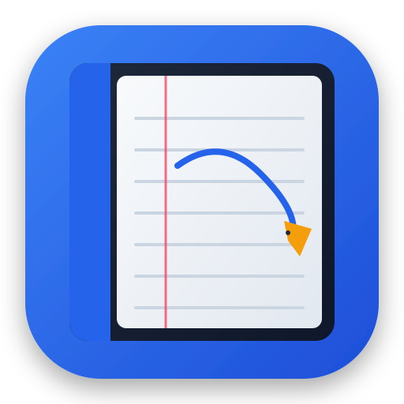
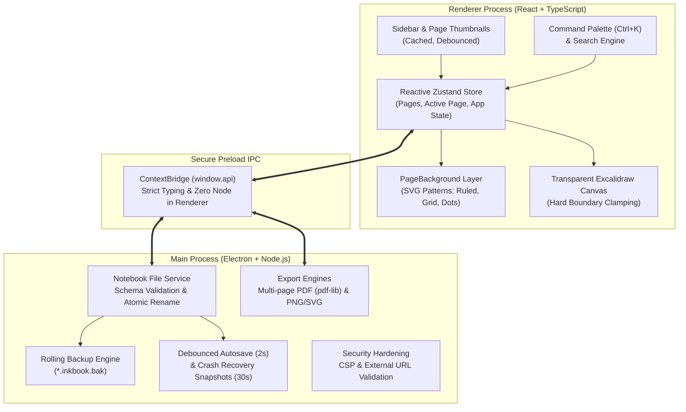

<div align="center">

  

  # InkBook

  **A fast, distraction-free Linux desktop digital notebook powered by Excalidraw.**

  [](https://github.com/sumitraj-saroj/InkBook/releases)
  [](https://github.com/sumitraj-saroj/InkBook/actions)
  [](LICENSE)
  [](https://archlinux.org/)
  [](https://www.electronjs.org/)
  [](https://excalidraw.com)
  [](https://www.typescriptlang.org/)
  [](https://vitest.dev/)

  <p align="center">
    <a href="#-key-features">Features</a> •
    <a href="#-installation--running">Installation</a> •
    <a href="#-architecture">Architecture</a> •
    <a href="#-keyboard-shortcuts">Shortcuts</a> •
    <a href="#-file-format">File Format</a> •
    <a href="#-contributing">Contributing</a>
  </p>

</div>

---

## 📖 Overview

**InkBook** combines the expressive, hand-drawn vector sketching capabilities of [Excalidraw](https://excalidraw.com) with the structured workflow of a physical notebook.

Unlike infinite-canvas tools where sketches sprawl unbounded, InkBook organizes your thoughts into **discrete, physical-sized pages** (A4, A5, or custom). Drawing is strictly constrained within each page boundary, and each page can feature its own customizable paper texture—**ruled, square grid, dot grid, or blank**.

InkBook is built Linux-first, featuring native **Wayland** and **X11** display support, atomic schema-validated file saves, rolling backups, multi-page vector PDF generation, and deep `.excalidraw` bidirectional compatibility.

---

## 🏗️ Architecture

InkBook employs a multi-tier architecture ensuring complete separation between the UI presentation, the Excalidraw vector engine, and safe atomic file persistence:



---

## ✨ Key Features

### 📄 Multi-Page Notebook Engine
- **Ordered Page Management**: Seamlessly add, delete, duplicate, and reorder pages within a notebook.
- **Page Presets**: Standard A4 Portrait (`794×1123 px`), A4 Landscape (`1123×794 px`), A5 Portrait (`559×794 px`), or custom pixel dimensions.
- **Real-Time Sidebar Thumbnails**: Cached, debounced previews with instant toggle between list and visual thumbnail views.
- **Smart Resizing**: When shrinking page dimensions, choose whether to scale elements to fit or clamp them—never lose work silently.

### 📐 Hard-Bounded Drawing Canvas
- The drawing canvas is strictly bounded to the physical dimensions of the active page.
- Mathematical boundary validation prevents shapes, arrows, lines, freehand strokes, and pasted elements from straying or being placed off-canvas.

### 📝 Per-Page Paper Backgrounds
- Rendered on a performant layer behind the transparent Excalidraw canvas, synchronized seamlessly with pan and zoom.
- **Ruled Paper**: Horizontal lines spaced at 32 px with a 96 px top margin and an optional vertical margin line.
- **Square Grid**: Crisp 32 px grid lines for diagrams, geometry, and technical sketches.
- **Dot Grid**: Modern 32 px dot matrix for bullet journaling and lightweight alignment.
- **Blank Paper**: Clean canvas texture for freeform art and mind-mapping.
- **Clean Scene Exports**: Backgrounds exist strictly in document metadata—exported `.excalidraw` files remain pure and unpolluted.

### 💾 Rock-Solid Atomic Persistence
- **Atomic Writes**: Writes first to a temporary file, calls `fsync()` to flush kernel buffers to physical storage, and atomically renames over the target file.
- **Rolling Backups**: Automatically maintains a `.inkbook.bak` copy of the previous version on every write.
- **Debounced Autosave**: Saves changes automatically 2 seconds after your last modification.
- **Crash Recovery Snapshots**: Keeps recovery states every 30 seconds for unsaved notebooks, offering instant one-click restoration upon relaunch.
- **Single-Instance Enforcement**: Double-clicking `.inkbook` files in file managers forwards the file directly to your active instance.

### 📤 Vector PDF & Media Export
- **Multi-Page Vector PDF**: Assembles entire notebooks into a single cohesive PDF using `pdf-lib`, preserving vector paths, page dimensions, and paper backgrounds.
- **High-Resolution PNG**: Export individual pages at 1x, 2x, or 3x scale with transparent or paper backgrounds.
- **Vector SVG**: Export infinite-resolution scalable vector graphics.
- **Excalidraw Compatibility**: Export clean `.excalidraw` files compatible with [excalidraw.com](https://excalidraw.com), or import existing drawings with automatic scale-to-fit.

### ⚡ Keyboard-First Productivity
- **Command Palette (`Ctrl+K`)**: Rapidly trigger any action, switch pages, adjust paper backgrounds, or toggle themes.
- **Full-Text Notebook Search**: Search across page titles and canvas text elements simultaneously, jumping straight to matched results.
- **Adaptive Dark / Light Theme**: Automatically tracks your system color scheme with persistent manual override.

---

## 🚀 Installation & Running

### Arch Linux

#### Native Pacman Package
Download the latest `inkbook-*.pacman` from [GitHub Releases](https://github.com/sumitraj-saroj/InkBook/releases) and install via `pacman`:

```bash
sudo pacman -U inkbook-1.0.0.pacman
```

#### Arch User Repository (AUR)
A complete PKGBUILD is included in [`packaging/arch/PKGBUILD`](packaging/arch/PKGBUILD). You can inspect and build it with `makepkg`:

```bash
cd packaging/arch
makepkg -si
```

---

### Universal AppImage (All Linux Distributions)

Download `inkbook-*.AppImage` from [GitHub Releases](https://github.com/sumitraj-saroj/InkBook/releases), make it executable, and launch:

```bash
chmod +x inkbook-1.0.0.AppImage
./inkbook-1.0.0.AppImage
```

> [!NOTE]
> Arch Linux and some modern distributions require the `fuse2` package to run AppImages:
> ```bash
> sudo pacman -S --needed fuse2
> ```

---

### Building from Source

#### Prerequisites
- **Linux** (Arch Linux rolling release, Fedora, Ubuntu, Debian, etc.)
- **Node.js** v20+ & **npm** v10+
- **Git**

```bash
# 1. Clone repository
git clone https://github.com/sumitraj-saroj/InkBook.git
cd InkBook

# 2. Install dependencies
npm install

# 3. Start development server with live reload
npm run dev

# 4. Package production binaries (AppImage & pacman)
npm run package
```

---

## 🖥️ Display Servers (Wayland & X11)

InkBook natively supports both modern Wayland compositors (Hyprland, Sway, GNOME, KDE Plasma) and traditional X11 window managers.

- **Automatic Detection**: InkBook starts with `--ozone-platform-hint=auto` and `enable-features=WaylandWindowDecorations`. Under Wayland sessions, it runs natively with fractional scaling support and client-side decorations.
- **Manual Overrides**:
  - Force native Wayland: `inkbook --ozone-platform=wayland`
  - Force X11 / XWayland: `inkbook --ozone-platform=x11`

---

## ⌨️ Keyboard Shortcuts

| Shortcut | Action |
| --- | --- |
| <kbd>Ctrl</kbd> + <kbd>N</kbd> | New Notebook |
| <kbd>Ctrl</kbd> + <kbd>O</kbd> | Open Notebook |
| <kbd>Ctrl</kbd> + <kbd>S</kbd> | Save Notebook |
| <kbd>Ctrl</kbd> + <kbd>Shift</kbd> + <kbd>S</kbd> | Save Notebook As... |
| <kbd>Ctrl</kbd> + <kbd>Shift</kbd> + <kbd>N</kbd> | Create New Page |
| <kbd>Ctrl</kbd> + <kbd>PageDown</kbd> | Navigate to Next Page |
| <kbd>Ctrl</kbd> + <kbd>PageUp</kbd> | Navigate to Previous Page |
| <kbd>F2</kbd> | Rename Active Page |
| <kbd>Ctrl</kbd> + <kbd>K</kbd> | Open Command Palette |
| <kbd>Ctrl</kbd> + <kbd>F</kbd> | Global Text & Title Search |
| <kbd>Ctrl</kbd> + <kbd>P</kbd> | Page Settings Dialog |
| <kbd>Ctrl</kbd> + <kbd>/</kbd> | Keyboard Shortcuts Help |
| <kbd>Ctrl</kbd> + <kbd>Z</kbd> / <kbd>Ctrl</kbd> + <kbd>Y</kbd> | Undo / Redo Canvas Action |

---

## 📁 File Format (`.inkbook`)

InkBook documents are human-readable, schema-validated JSON files with the `.inkbook` extension.

```jsonc
{
  "version": 1,
  "title": "My Notebook",
  "activePageId": "page-1",
  "pages": [
    {
      "id": "page-1",
      "title": "Architecture Overview",
      "width": 794,
      "height": 1123,
      "background": {
        "style": "ruled",         // "ruled" | "grid" | "dots" | "blank"
        "showMarginLine": true     // Optional vertical margin for ruled style
      },
      "elements": [ /* 100% standard Excalidraw element objects */ ],
      "appState": {
        "viewBackgroundColor": "transparent"
      },
      "files": { /* Embedded images dictionary */ }
    }
  ],
  "createdAt": "2026-10-26T00:00:00.000Z",
  "updatedAt": "2026-10-26T00:15:00.000Z"
}
```

---

## 🧪 Testing & Verification

InkBook maintains a rigorous test suite using [Vitest](https://vitest.dev/):

```bash
# Run 133 unit and integration tests across 19 suites
npm test

# Run strict TypeScript type checks for Node & Web environments
npm run typecheck

# Run ESLint validation
npm run lint
```

For detailed cross-distribution verification guidelines in isolated containers (Ubuntu and Fedora via Distrobox/Podman), see [docs/TESTING.md](docs/TESTING.md).

---

## 🔒 Security

InkBook implements strict desktop security practices:
- Fully enabled Context Isolation (`contextIsolation: true`) and disabled Node integration in the renderer.
- Strict Content Security Policy (CSP) blocking unauthorized scripts and remote resource loading.
- Navigation interception blocking external URLs from loading inside the app, routing validated schemes (`http`, `https`, `mailto`) to your default browser.
- Developer tools automatically disabled in production builds.

For details, review [SECURITY.md](SECURITY.md).

---

## 🤝 Contributing

Contributions, bug reports, and suggestions are warmly welcomed! Please read our [CONTRIBUTING.md](CONTRIBUTING.md) guide and adhere to our [Code of Conduct](CODE_OF_CONDUCT.md).

---

## 📄 License & Attribution

- **InkBook** is distributed under the terms of the [MIT License](LICENSE).
- Powered by [Excalidraw](https://github.com/excalidraw/excalidraw) (MIT License). See [NOTICE](NOTICE) for full third-party copyright and license notices.
